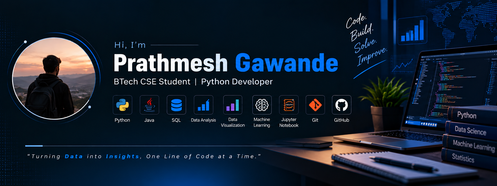

  

# Hi, I'm Prathmesh Gawande 👋

### BTech Computer Science & Engineering Student | Python Developer

I'm a Computer Science student passionate about software development, data analysis, and building practical technology projects. I enjoy learning new tools, solving problems, and turning ideas into working applications.

- 🎓 Pursuing BTech in Computer Science & Engineering
- 💻 Interested in Python, Machine Learning, Data Science
- 🔍 Currently improving my development and problem-solving skills
- 🚀 Building projects that combine programming with real-world applications

---
## 🛠️ Languages and Tools

  
  
  
  
  
  

## 🛠️ Tech Stack

**Languages:** Python, Java, SQL    
**Web Development:** HTML, CSS  
**Tools:** Git, GitHub, VS Code, Jupyter Notebook

---

## 🚀 Featured Project

### Signature Identification System

A Python-based application for signature identification, with a trained identification model and web interface.

**Technologies:** Python, Machine Learning, Flask, HTML, CSS

[View Project Repository](https://github.com/prathmeshgawande83-ship-it/signature-identification-system)

---

## 📚 Currently Learning

- Data Science and Machine Learning
- Python development and model evaluation
- Data structures and algorithms
- Software engineering and backend development

---

## 🤝 Connect With Me

- **GitHub:** [@prathmeshgawande83-ship-it](https://github.com/prathmeshgawande83-ship-it)

I'm always interested in learning, collaborating, and building useful projects.

---

*“Learning by building, improving with every project.”*
